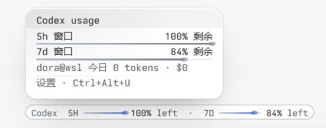

# dora-tern-omp-usage

**Dora omp Usage** — your omp usage limits shown just above the omp composer's context bar in
[Tern](https://stencil.so/tern), for **every provider omp reports** (Kimi, Codex, Claude, Gemini, MiniMax, …),
plus today's tokens & API-price cost with a per-provider breakdown, a 7-day dashboard, and a settings panel.



> 中文说明:[README.md](README.md)

## Installation

Installation has two parts: **step 1, the Tern plugin** (required — all collection and display), and
**step 2, the omp identity extension** (optional — exact main-session model following). The plugin works
on its own; what changes without the extension is described in [step 2](#step-2-install-the-identity-extension-optional).

### Step 1: install the Tern plugin (required)

Tern 0.8+. One-line install:

```sh
tern plugin install github.com/DoraJasmine/dora-tern-omp-usage
```

Or paste the same address into Tern's **Preferences › Plugins › Install…** You immediately get everything in
"What it shows": per-provider limit bars, pay-as-you-go today spend, the hover card, today's tokens & cost,
the 7-day dashboard and the settings panel. Data comes from the `omp usage` / `omp stats` CLI; the plugin
never reads or writes omp configuration, and providers omp signs into later need no plugin update.

### Step 2: install the identity extension (optional)

The bundled `omp/extensions/model-identity.js` requires omp **18.18.0+** (exercised with Windows and WSL
omp 18.18.0; CLI usage collection is independent of the extension and works on any omp). The identity bridge
was exercised in isolated headless Tern 0.9.12; older native-node compatibility is not verified.

**What the extension does**: a hidden native node passes the live main-session provider/id/sessionId to the
plugin, so current-model mode follows exactly and distinguishes models with identical names and bare ids,
without sending a message. The extension does not poll, write files, or change the model chip.

**Without it** the plugin still works, resolving identity from the displayed name alone:

- a unique displayed name still resolves exactly;
- same-name cross-provider models show **every candidate provider** side by side with a `same-name ×N`
  marker, never guessing one; a candidate with no own data is omitted while the marker stays;
- multiple candidates within one provider, all candidates without data, an invalid or unsupported bridge, or
  a duplicate name on a viewed child remain pending with hover guidance.

Load it on **each host running omp** (never only on the Windows machine running Tern; each WSL distribution
and SSH host separately), picking **one** method per host — loading twice makes duplicate nodes, which are
treated as an invalid bridge and shown as pending:

1. **One-line install (recommended)** — installs into omp's user plugin directory, effective for every local
   omp session; upgrade later with `omp plugin upgrade`:

   ```sh
   omp plugin install github:DoraJasmine/dora-tern-omp-usage
   ```

   For a local checkout, `omp plugin link <path-to-repo>`; source edits show through the link. Restart the omp
   session or run `/reload-plugins` after installing or upgrading.

2. **Discovery directory** — copy the single file to `~/.omp/agent/extensions/` on that host (on Windows:
   `C:\Users\<you>\.omp\agent\extensions\`); omp auto-scans `.js` modules there. A copy under a project's
   `.omp/extensions/` applies to that project only. The file can be copied straight out of the Tern plugin's
   install directory (Windows: `%APPDATA%\Tern\plugins\dora-tern-omp-usage\omp\extensions\`) without cloning
   this repo — but a hand copy will not follow plugin updates.

3. **Register in config.yml** — obtain this repository (for example, clone it to a stable directory) and add
   the extension's **absolute path** to the existing `extensions` list in that host's omp `config.yml`,
   preserving other entries:

   ```yaml
   extensions:
     - 'D:/Tern/dora-tern-omp-usage/omp/extensions/model-identity.js'
   ```

   That example is for Windows omp. For WSL/Linux omp use a host-accessible POSIX path, such as
   `/home/me/dora-tern-omp-usage/omp/extensions/model-identity.js`. A checkout on Windows drive D is
   accessible from WSL as `/mnt/d/Tern/dora-tern-omp-usage/omp/extensions/model-identity.js`. For SSH, place
   the file on the remote host and use its remote absolute path. Restart the corresponding omp session to load
   the configuration.

4. **Explicit launch** — without editing configuration (this disables other automatically discovered
   extensions):

   ```sh
   omp --no-extensions -e /absolute/path/to/dora-tern-omp-usage/omp/extensions/model-identity.js
   ```

   Windows PowerShell: `omp --no-extensions -e 'D:/Tern/dora-tern-omp-usage/omp/extensions/model-identity.js'`.

A viewed child never inherits the main session's identity; duplicate child names remain pending. See
[identity and limits](docs/CHIP-AMBIGUITY.md).

## What it shows

- **Usage line** above the focused omp pane's context hairline: per-window bars filled to the share left, with
  reset countdowns and saved resets, in each provider's colors (amber at 25% left, red at 10%).
- **Pay-as-you-go providers**: a provider with no subscription window never shows up in the usage report, so it
  falls back to today's spend — `Bailian  TODAY 24.6M · $0.43`, no bar — and still appears in the card, the
  provider toggles and the ordering menu.
- **Hover card** with per-window meters, reset times and clock times, saved-reset expiries, today's totals and
  settings shortcut. It stays open while you point at it.
- **Model follow**: the companion exposes the live main-session provider/id, distinguishing models with identical names and bare ids without sending messages. Identity is checked every 100 ms; switches render the matching provider's cached data before requesting a background quota refresh. This is not a hard latency guarantee. Without the bridge, a unique displayed name resolves normally, while same-name providers are all shown with a `same-name ×N` marker instead of guessing one. While viewing a child, only a unique exact displayed-name catalog match resolves; otherwise the line shows a helpful pending notice.
- **Per-host data**: a pane on WSL or an SSH host shows that host's accounts and stats, collected through the corresponding host transport; local panes show local data. Exact identity additionally requires loading the companion on that host.
- **Status bar**: 🔥 today's tokens and 💸 today's API-price cost for the focused pane's host.
- **Dashboard**: 7 days of usage history plus today/week/month API-price cost (`r` refreshes).
- **Settings** (`Ctrl+Alt+U`, the status-bar `usage` segment, or the palette): show mode (current model /
  all providers / selected), provider order, per-provider colors, thresholds, usage and today-stats refresh
  intervals, status-bar toggles, language (English / 简体中文).

## How the numbers are computed

- **Limits** come from `omp usage --json` — account-level, whatever providers omp is signed into. New providers
  appear with zero code changes.
- **Today** sums `omp stats --json` hourly buckets since local midnight. The per-provider breakdown aggregates
  `byModel` (input + output + cache tokens, the same semantics as the total).
- **Pay-as-you-go providers** have no limit window at all, so the only trace they leave is that per-provider
  breakdown; the line shows that spend instead of a bar.
- **Prices** come from omp's model catalog (`omp models --json`): the API list price per million tokens for
  input, output, cache reads and cache writes. The dollar amounts are therefore the **API-equivalent cost** of
  your usage — what it would have cost at API rates — not your subscription bill.
- **Current-model mode** never substitutes another provider: a resolved provider without usage or today's spend gets its own no-data notice. Pending identity has hover guidance and diagnostics; all/selected modes retain their existing behavior.
- Upgrading to 2.0.0 refetches legacy case-folded quota/catalog/today caches and rebases the provider ledger and cumulative baseline together. Daily-total history is preserved; provider attribution retains the existing reconciliation algorithm.

### How fresh the limits are

Limit numbers are not real-time: omp keeps a ~**5-minute** (±25% jitter) local cache of upstream usage reports
and answers repeat queries from it. The TTL is hardcoded in omp with no configuration surface, so polling more
often cannot buy fresher data. Worst-case staleness is roughly cache TTL plus this plugin's refresh interval
(default 90 s, adjustable in settings). The plugin's **Refresh now** command calls omp's official
`omp usage invalidate`, which bypasses the cache and is the fastest way to get up-to-date limits.
See [the architecture document](docs/ARCHITECTURE.md) §16 for details.

## Multi-host

Tern windows can show panes from multiple hosts. The plugin maps the focused pane to its data source and collects each source independently: local CLI execution, `wsl.exe` for WSL distributions, and SSH for remote hosts. Accounts, usage and statistics remain source-specific. Install/load the identity extension separately wherever omp runs; a Windows extension path is not automatically a usable remote path.
Unmapped hosts never borrow local data. A WSL host name that cannot distinguish multiple installed distributions stays unavailable rather than selecting the first distribution.

## Development

```sh
git clone https://github.com/DoraJasmine/dora-tern-omp-usage
tern plugin link ./dora-tern-omp-usage   # link your checkout
tern plugin reload dora-tern-omp-usage   # after edits
tern plugin types ./dora-tern-omp-usage  # regenerate tern.d.luau for luau-lsp
```
Pure regression scripts can also run with the standalone Luau CLI:

```sh
luau tests/identity.luau
luau tests/line.luau
```


`docs/` carries the (Chinese) requirements and architecture documents, the
[implementation guide](docs/IMPLEMENTATION.md) and the [API usage reference](docs/API.md).

## Credits

- [jmazzola/tern-plugin-omp-usage](https://github.com/jmazzola/tern-plugin-omp-usage) (MIT) — the CSS technique
  this plugin's line and card rendering is adapted from (the composer meter's `::before` content with one
  `background-clip: text` gradient).
- [joaodutra88/tern-omp-usage](https://github.com/joaodutra88/tern-omp-usage) (MIT) — the pure-Tern-plugin
  fetch architecture, status-line segments, dashboard block and per-day stats accumulation this build extends
  to every provider and host.

## License

[MIT](LICENSE) © 2026 DoraJasmine — third-party attributions and notices:
[THIRD-PARTY-NOTICES.md](THIRD-PARTY-NOTICES.md)
