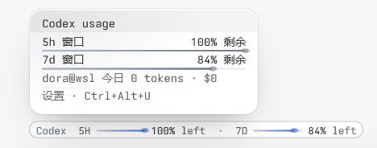

# dora-tern-omp-usage

**Dora omp Usage** 是一款 [Tern](https://stencil.so/tern) 插件,把 omp 各家服务的订阅额度展示在输入栏上方的上下文用量条处,支持 omp 所有的提供商——Kimi、Codex、Claude、Gemini、MiniMax 等,并附带当日 token 用量与费用统计、近 7 天仪表盘和完善的设置界面。



English: [README.en.md](README.en.md)

## 功能

- **额度展示**——聚焦 omp 窗格后,各家服务的 5 小时 / 7 天等窗口用量一目了然:填充条、剩余比例、重置倒计时,逐家配色;余量不足时自动转为琥珀色和红色。
- **按量计费的服务**——没有订阅窗口(因而不在额度报告里)的服务,退一步显示当日消耗:`Bailian  TODAY 24.6M · $0.43`,没有进度条;它同样出现在卡片、设置里的服务开关与排序中。
- **悬浮卡片**——鼠标停在用量线上,即可查看各窗口的计量器、重置时间与已存重置的到期时间;卡片支持悬停停留,不会一闪而过。
- **模型跟随**——主会话加载下述身份拓展后,直接读取当前 provider/id,同名甚至同 id 的跨提供商模型也可区分;无需发送消息。每 100 ms 检查身份变化,先显示对应供应商的缓存数据,再由后台刷新额度;不是硬实时保证。未加载拓展时,唯一显示名照常解析;同名多供应商则同时显示全部候选并标注 `同名 ×N`,不猜具体一家。查看子代理时仍只接受唯一精确显示名,否则显示待确认及说明。
- **多主机**——按 Tern 主机归属读取各源数据;无法映射的主机不借用本机数据,多个 WSL 发行版无法区分时也不猜选第一家。身份拓展需分别在各 omp 主机加载。
- **当日统计**——状态栏常驻当日 token 用量与费用,点击可打开近 7 天仪表盘。
- **设置**——通过 `Ctrl+Alt+U` 或命令面板打开:显示模式、服务排序、逐家配色、阈值、用量与当日统计的刷新间隔、界面语言(English / 简体中文)等。

## 安装

安装分两步:**第 1 步装 Tern 插件**(必需,提供全部取数与显示);**第 2 步装 omp 身份拓展**(可选,用于精确跟随主会话模型)。只装插件即可正常使用;没装拓展时的显示行为见[第 2 步](#第-2-步安装身份拓展可选)。

### 第 1 步:安装 Tern 插件(必需)

要求 Tern 0.8 及以上。一行安装:

```sh
tern plugin install github.com/DoraJasmine/dora-tern-omp-usage
```

也可以在 Tern 的 **设置 › 插件 › Install…** 中粘贴上述地址。装完即有「功能」一节的全部能力:各家服务的额度展示、按量计费服务的今日消耗、悬浮卡片、当日 token 与费用统计、近 7 天仪表盘与设置界面。取数走 `omp usage` / `omp stats` CLI,插件不读写 omp 配置,omp 新登录的服务无需更新插件。

### 第 2 步:安装身份拓展(可选)

随仓库分发 `omp/extensions/model-identity.js`,要求 omp **18.18.0 及以上**(已在 Windows 与 WSL 的 omp 18.18.0 验证;CLI 用量采集独立于此拓展,任何 omp 版本照常工作)。身份桥已在 Tern 0.9.12 的隔离无界面环境验证,旧版原生节点兼容性未验证。

**拓展的作用**:以隐藏原生节点把主会话实时的 provider/id/sessionId 传给插件,让「当前模型」模式精确跟随,区分同名甚至同 id 的跨提供商模型,无需发送消息。拓展不轮询、不写文件、不改变模型芯片布局。

**没装拓展时**,插件照常工作,身份按模型显示名尽力解析:

- 显示名唯一的模型照常精确解析;
- 同名跨提供商模型并列显示**全部候选供应商**并标注 `同名 ×N`,不猜具体一家;某家没有自身数据时仅省略该项,标记保留;
- 同一提供商内有多个候选、全部候选都没有数据、身份桥非法或不支持、查看子代理时重名,仍显示待确认与悬停说明。

拓展需在**每个运行 omp 的主机**装载(不能只装在 Tern 所在 Windows 上;多个 WSL 发行版与 SSH 主机分别装),同一主机**任选一种**方式、不要重复装载——重复节点会被判定为非法桥,显示待确认:

1. **一行安装(推荐)**——安装到 omp 用户插件目录,对本机所有 omp 会话生效;之后可用 `omp plugin upgrade` 升级:

   ```sh
   omp plugin install github:DoraJasmine/dora-tern-omp-usage
   ```

   本地检出版可用 `omp plugin link <仓库路径>` 链接,源码改动即时可见。安装或更新后重启对应 omp 会话,或执行 `/reload-plugins` 生效。

2. **发现目录**——把单个文件复制到该主机的 `~/.omp/agent/extensions/`(Windows 即 `C:\Users\<用户名>\.omp\agent\extensions\`),omp 会自动扫描加载其中的 `.js` 模块;放进某个项目的 `.omp/extensions/` 则只对该项目生效。文件可直接从 Tern 插件安装目录复制(Windows 为 `%APPDATA%\Tern\plugins\dora-tern-omp-usage\omp\extensions\`),无需 clone 仓库,但手动复制不会随插件更新。

3. **config.yml 注册**——先取得本仓库文件(例如 clone 到固定目录),在对应主机的 omp `config.yml` 中将拓展的**绝对路径**加入已有 `extensions` 列表,保留其他配置:

   ```yaml
   extensions:
     - 'D:/Tern/dora-tern-omp-usage/omp/extensions/model-identity.js'
   ```

   上例适用于 Windows omp。WSL/Linux omp 应使用该主机可访问的 POSIX 路径,例如 `/home/me/dora-tern-omp-usage/omp/extensions/model-identity.js`;若仓库在 Windows D 盘,WSL 中为 `/mnt/d/Tern/dora-tern-omp-usage/omp/extensions/model-identity.js`。SSH 主机需把文件放到远端并使用远端绝对路径。重新启动对应 omp 会话使配置生效。

4. **显式启动**——不修改配置,在该主机上显式加载(此命令会禁用其他自动发现的拓展):

   ```sh
   omp --no-extensions -e /absolute/path/to/dora-tern-omp-usage/omp/extensions/model-identity.js
   ```

   Windows PowerShell 示例: `omp --no-extensions -e 'D:/Tern/dora-tern-omp-usage/omp/extensions/model-identity.js'`。

查看子代理时不使用主会话身份,重名仍会待确认。详见[身份与限制](docs/CHIP-AMBIGUITY.md)。

## 数据说明

- 额度数据来自 `omp usage --json`,omp 登录了哪些服务就展示哪些,新服务无需更新插件;
- 当日统计自当地零点起,覆盖所有服务,金额按 omp 模型目录中的 API 牌价折算——反映的是"若按 API 直连计费"的等效费用,并非订阅账单;
- 按量计费(没有订阅限额窗口)的服务不会出现在额度报告里,只在当日统计中留痕,用量线上以今日消耗的形式出现。
- 「当前模型」模式只显示已解析的自身提供商;该提供商暂无用量/今日消费时显示自身无数据提示,绝不借用其他提供商。身份缺失、冲突或不支持时显示待确认;可悬停查看原因,通过诊断命令查看身份来源与状态。「全部/已选」模式不受此限制。
- 升级 2.0.0 时,旧版小写化的额度/目录/今日缓存会重新拉取,按供应商的累计基线与账本一起重建,避免合并大小写不同的供应商。每日总量历史 `days@<source>` 保留;供应商分摊沿用既有对账算法。

### 关于额度的更新时效

额度数字并非实时:omp 对上游用量报告维护约 **5 分钟**(±25% 抖动)的本地缓存,缓存期内再次查询返回同一份报告;缓存 TTL 由 omp 硬编码,不提供配置入口,因此插件无法(也不应)通过更频繁的轮询换取更新的数据。实际的数据延迟最坏约为"缓存有效期 + 插件刷新间隔"(默认 90 秒,可在设置中调整)。插件的「立即刷新」会调用 omp 官方的 `omp usage invalidate` 接口强制绕过缓存,是最快拿到最新额度的途径。详见[架构文档](docs/ARCHITECTURE.md)第 16 节。

## 相关文档

- [实现指南](docs/IMPLEMENTATION.md) —— 文件结构、数据流水线与常见修改
- [Tern API 使用说明](docs/API.md) —— 插件用到的每一个 Tern API
- [需求文档](docs/REQUIREMENTS.md) · [架构文档](docs/ARCHITECTURE.md)

## 致谢

- [jmazzola/tern-plugin-omp-usage](https://github.com/jmazzola/tern-plugin-omp-usage) —— 线条与卡片的渲染方案参考自此项目
- [joaodutra88/tern-omp-usage](https://github.com/joaodutra88/tern-omp-usage) —— 取数架构、状态栏与仪表盘的实现思路参考自此项目

## 许可

[MIT](LICENSE) © 2026 DoraJasmine,第三方组件声明见 [THIRD-PARTY-NOTICES.md](THIRD-PARTY-NOTICES.md)。
